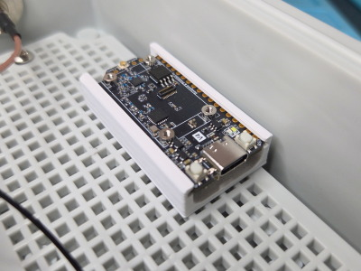
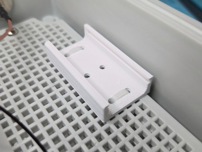
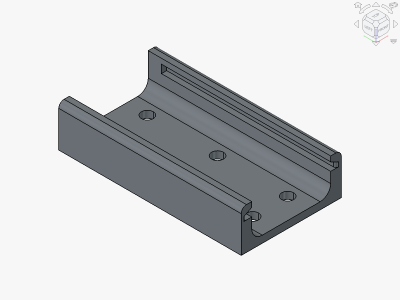

# Heltec LoRa V4 Holder

<table>
<tr>
<td></td>
<td></td>
</tr>
<tr>
<td></td>
<td></td>
</tr>
</table>

A 3D printable holder for the Heltec WiFi LoRa 32 V4 with 5mm spaced mounting holes for zip-ties or M3 bolts. Prints flat with no supports. Made with FreeCAD.

**Design:** [heltec-lora-v4-holder.FCStd](heltec-lora-v4-holder.FCStd)

**STL:** [heltec-lora-v4-holder.stl](stl/heltec-lora-v4-holder.stl)

**Recommended Print Settings:** 0.20mm layer height, 100% infill, print flat with no supports, PLA/PLA+/ASA

**Printables:** https://www.printables.com/model/1892575-heltec-wifi-lora-32-v4-holder-zip-ties-or-m3-bolts

**Thingiverse:** https://www.thingiverse.com/thing:7427554

**License**: 
